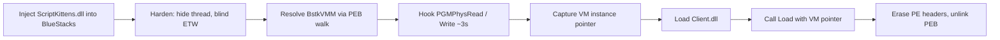

<div align="center">

# Script Kittens AOTBST

**Hypervisor bridge DLL for the Script Kittens Internal Panel**


Gives `Client.dll` raw physical memory access to the Free Fire guest running inside BlueStacks — then hides itself.

</div>

---

## Overview

Free Fire runs inside BlueStacks, which runs it inside a VirtualBox virtual machine. The game's memory lives in the guest's physical memory, not in any normal Windows process — so a regular internal cheat cannot reach it.

**AOTBST is the bridge.** It hooks VirtualBox's own memory functions, captures the live VM instance, and hands it to the Internal Panel (`Client.dll`). From that point the panel reads and writes game memory through the bridge's exports, while the bridge erases itself from the process.

## How It Works



1. **Hardens itself first** — hides its thread from debuggers (`NtSetInformationThread`) and blinds ETW telemetry (`EtwEventWrite` → `RET`).
2. **Finds BlueStacks' VMM** — resolves `BstkVMM.dll` and its exports (`PGMPhysRead`, `PGMPhysSimpleWriteGCPhys`, `PGMPhysGCPtr2GCPhys`, `VMMGetCpuById`) by walking the PEB manually. No `GetProcAddress`, no plaintext strings — every module and export name is matched by hash, and every string is XOR-encrypted at compile time.
3. **Captures the VM pointer** — hooks the physical read/write with MinHook for ~3 seconds, just long enough to catch the VM instance the first time VirtualBox calls them, then removes the hooks immediately. The hooks are transient by design.
4. **Hands off to the cheat** — loads `Client.dll` and calls its `Load(vmInstancePtr)`.
5. **Erases itself** — zeroes its own PE headers and unlinks itself from all three PEB loader lists. `Client.dll` already cached the function pointers, so it is safe to disappear.

## Usage

### With the Internal Panel (`Client.dll`)

1. Build `ScriptKittens.dll` (x64 / Release).
2. Place it in the **same folder** as `Client.dll`.
3. Inject `ScriptKittens.dll` into the BlueStacks process (`HD-Player.exe`).
4. The bridge does the rest — it finds the VMM, captures the VM pointer, loads `Client.dll` itself, and hands it the live VM handle. You do **not** load `Client.dll` separately.
5. The panel runs on top of the bridge: ESP, aimbot, and every other feature read and write game memory through the exports below.

### With the C# App (AotForms)

Add `ScriptKittensInternalMemory.cs` to your project. It P/Invokes the bridge's four exports and wraps them in a typed API:

```csharp
InternalMemory.Initialize(pVM);          // VM pointer captured by the bridge
InternalMemory.Read<ulong>(address, out var value);
InternalMemory.ReadArray<ulong>(address, ref array);
InternalMemory.ReadString(address, size);
InternalMemory.Write<ulong>(address, value);
```

Guest addresses are translated to physical addresses automatically, with an address cache you can switch off via `Config.NoCache`.

### How `Client.dll` Is Loaded

The bridge loads the panel itself — nothing else has to:

- It builds the path from its own location: its folder + `\Client.dll`.
- `LoadLibraryA` loads it, then the bridge resolves the panel's `Load` export by walking the PEB (hash-matched, no `GetProcAddress`).
- `Load` is only called **after** the VM pointer is captured. If the VMM is not found or the pointer is not captured within 3 seconds, the panel is never started.
- `Load(vmInstancePtr)` hands the cheat the live VM handle. From then on, `Client.dll` uses the bridge's exports for all memory access — it never touches the VMM directly.

## Exports

Used by `Client.dll` and the C# app:

| Export | What it does |
| --- | --- |
| `CPU(pVM, cpuId)` | Get a vCPU handle for the VM |
| `InternalRead(pVM, address, buffer, size)` | Read guest physical memory |
| `Cast(pVCpu, address, &physAddress)` | Translate a guest address to a physical address |
| `InternalWrite(pVM, address, buffer, size)` | Write guest physical memory |

## Project Structure

| File | What it is |
| --- | --- |
| `ScriptKittensDllMain.cpp` | The bridge: hardening, VMM hook, handoff, self-erase |
| `PEBWalk.h` | Manual PEB module/export resolution (no winternl.h) |
| `XorStr.h` | Compile-time XOR string encryption |
| `ScriptKittensInternalMemory.cs` | C# wrapper (`AotForms`) — typed reads/writes with an address cache |
| `Minhook/` | MinHook hooking library (vendored) |

## Build

1. Open `ScriptKittens.sln` in Visual Studio 2022+.
2. Build **x64 / Release**.
3. Output: `ScriptKittens.dll` — place it next to `Client.dll`.

## Requirements

- Windows 10/11, x64
- Visual Studio 2022+ (v143 toolset)
- BlueStacks running (the target process must have `BstkVMM.dll` loaded)
- `Client.dll` in the same folder as `ScriptKittens.dll`

## Notes

- The VMM hooks live for ~3 seconds only — long enough to capture the VM pointer, then they are gone.
- No plaintext API names in the binary: module and export resolution is hash-based, and strings are XOR-encrypted at compile time (seeded from the build time, so every build encrypts differently).
- The bridge unlinks itself from the PEB after the handoff. `Client.dll` resolves the exports by name through its own PEB walk, so the rename from `GTCBst.dll` to `ScriptKittens.dll` does not break it.
